<p align="center">
  <a href="https://the-foundry-alpha.vercel.app"><b>Site</b></a> ·
  <a href="https://github.com/TheHackBrasil/foundry/releases/tag/pitch-v10"><b>Pitch em vídeo (v10)</b></a> ·
  <a href="./docs/escopo.md">Escopo</a> ·
  <a href="./DECISIONS.md">Decisões</a> ·
  <a href="./BACKLOG.md">Backlog</a>
</p>

**The Foundry** é uma camada de coordenação para logística B2B. Ela conecta os
sistemas que fornecedor, transportadora, centro de distribuição, fiscal e
financeiro já usam e avisa todos quando um pedido muda.

> **Estado:** hipótese em construção, MVP em build (`specs/0004`). Time da trilha
> Logística & Automação do HackBrasil 2026, com submissão em 30/11. Este repo
> registra o processo inteiro, da pesquisa de campo à entrega.

## O problema

Quando um parceiro atrasa ou muda algo, o efeito se espalha pela cadeia.
Pedidos, prazos, contratos e documentos ficam em sistemas diferentes, e as
equipes acertam a diferença por ligação e conferência manual.

O galpão mostra o mesmo padrão em escala menor: etiquetas e códigos variam
entre fornecedores, e kits, lotes e peso variável complicam o registro e a
documentação na entrada. A TOTVS trouxe o aprendizado que orienta o desenho:
o setor não é letrado digitalmente, e solução que exige mudança de rotina
morre na gaveta.

## Como funciona (hipótese)



1. **Lê o que cada parceiro já produz.** ERP, XML de NF-e, PDF, planilha.
   Ninguém troca de sistema; a integração precisa ser trivial.
2. **Mantém um registro único do pedido.** Uma versão compartilhada entre
   fornecedores, operadores e áreas financeira e fiscal.
3. **Avisa quando as versões divergem.** Atrasos, divergências e pendências
   aparecem para todos antes de virar efeito dominó.

Isto é a hipótese de produto da call de 16/11, não um sistema em operação.
Ainda não medimos o retorno de uma solução.

## Escopo

**Decidido**

- Direção: coordenação entre fornecedores, operadores logísticos e áreas
  financeira e fiscal (D-002).
- Simplicidade de adoção é requisito. API aberta e documentação que um leigo
  consiga seguir.
- Recorte do MVP: pipeline de documentos reais (NF-e, CT-e, CC-e,
  e-mail, planilha) alimentando um motor de divergência; o atraso
  propagado é o cenário da demo (D-015 refinado em D-018,
  `specs/0004`). Os demais candidatos entram no mesmo modelo como
  tipos de documento/divergência:

| Candidato | O que é |
|---|---|
| **Atraso propagado** | Um parceiro atrasa; alertar e coordenar os demais, incluindo o financeiro |
| Documentos fiscais / NF | Registro e documentação da carga de ponta a ponta |
| Recebimento / etiquetas | Padronizar códigos e conferência na entrada do galpão |
| Contratos / conciliação | Revalidar contratos e pagamentos quando a operação muda |

**Fora**

- Roteirização interna. O mercado já tem muitas soluções, a decisão exige
  algoritmo determinístico (OR-Tools) e, para PMEs, depende de hardware.
- Blockchain como requisito. É opção de registro compartilhado, adotada só se
  a camada precisar de confiança entre empresas que não se conhecem (D-003).
- Promessa de implantação real antes de 30/11.

**Em aberto**

- Leitura candidata, em discussão: capacidade ociosa (doca livre, espaço de
  retorno, posição de estoque) entraria como tipo de dado na camada, não como
  marketplace.

Detalhes, riscos mapeados e próximos passos em [`docs/escopo.md`](docs/escopo.md).

## Pesquisa de campo



A investigação veio antes do produto. A maior parte das conversas começou na
**FENATRAN** (São Paulo Expo, novembro de 2026). Na **call de alinhamento de
16/11** (cerca de 1h43), o time escolheu a direção de escopo.

| Fonte | O que trouxe |
|---|---|
| TOTVS (especialista em logística) | Clientes reclamam da gestão de vários parceiros logísticos e da cascata financeira. Vender solução complexa ao setor não funciona. |
| Schulz Tech (mentor) | Roteirização é o ativo real e usa OR-Tools, não LLM. Digital Twin é aditivo visual. |
| Kaufmann (estande FENATRAN) | Automação de esteiras para galpões e fábricas. |
| CAP Logística (diretora, parceria GCCA) | Convite para visitar galpões, pela ponte de Isabela Claro Sanches. |
| Especialista em armazéns, Vivianne Moreira Leite | Gargalos de recebimento, etiquetagem e expedição; caos de etiquetas entre fornecedores. |
| Emiteaí (estande FENATRAN) | Referência de comparação: emissão de documentos de rota. A diferenciação segue em aberto. |
| Enviagora (Rafael Alberto Born, CEO) | Call de descoberta reagendada. Objetivo: um caso real bem entendido e qual dor investigar primeiro. |

Os contatos citados não são depoimentos nem endossos. Fontes completas em
[`docs/fontes-e-contatos.md`](docs/fontes-e-contatos.md); resumo e transcrição
da call em [`docs/`](docs/).

## Estado atual

- **Em execução:** build do MVP da camada de coordenação
  ([`specs/0004`](specs/0004-mvp-atraso-propagado/spec.md)) em três frentes
  paralelas; meta de demo funcional em 23/11 e entrega em 30/11.
  Escopo fechado em 20/11 (D-015, refinado em D-018).
- **Pitch:** v10 publicado na
  [release `pitch-v10`](https://github.com/TheHackBrasil/foundry/releases/tag/pitch-v10)
  (D-014).
- **Site:** no ar na identidade da marca
  ([the-foundry-alpha.vercel.app](https://the-foundry-alpha.vercel.app),
  specs 0002 e 0003).
- Decisões, achados e pendências datados em [`DECISIONS.md`](DECISIONS.md);
  specs em [`specs/`](specs/).

## Como o repo está organizado

| Caminho | O que tem |
|---|---|
| [`app/`](app/) | MVP da camada de coordenação: `shared`, `server`, `web`, `contracts`, `seed` (um dono por pasta) |
| [`docs/`](docs/) | Pesquisa e escopo: plano do MVP, resumo e transcrição da call, fontes e contatos, dossiê da visão de arco |
| [`site/`](site/) | Site do diário (Astro + TypeScript) |
| [`app/`](app/) | MVP da camada (spec 0004): API de eventos, ledger verificável, torre de controle, contratos |
| [`slides/`](slides/) | Deck de descoberta preparado para a call Enviagora |
| [`specs/`](specs/) | Specs de cada mudança não trivial; a `0004` guarda o plano e os briefs das frentes |
| [`PRODUCT.md`](PRODUCT.md) · [`DECISIONS.md`](DECISIONS.md) · [`BACKLOG.md`](BACKLOG.md) · [`RULES.md`](RULES.md) | Produto, log de decisões, fila de trabalho, regras da competição |
| [`AGENTS.md`](AGENTS.md) · [`STYLE.md`](STYLE.md) · [`.specify/`](.specify/) · [`speckit/`](speckit/) | Como mudanças acontecem aqui e como a prosa é escrita |
| [`scripts/`](scripts/) | Verificação local: `repo-guard.mjs` e `prose-evals.mjs` |

Antes de qualquer commit:

```bash
node scripts/repo-guard.mjs && node scripts/prose-evals.mjs
```

## Para quem desenvolve (pessoas e agentes)

O MVP sai em quatro frentes paralelas, cada uma com worktree, branch
`wt/<nome>` e brief próprio (spec 0004; mecanismo na spec 0005, D-019 e D-021).
A `main` só recebe commit de integração.

| Frente | Branch | Worktree | Escreve em | Brief |
|---|---|---|---|---|
| `app-core` | `wt/app-core` | `../foundry-wt-app-core` | `app/shared/`, `app/server/ingest/` | [brief-core.md](specs/0004-mvp-atraso-propagado/brief-core.md) |
| `app-infra` | `wt/app-infra` | `../foundry-wt-infra` | `app/server/*.ts`, `app/server/db/`, `app/contracts/`, `app/package.json`, `app/tsconfig*.json`, `app/docker-compose.yml`, deploy | [brief-infra.md](specs/0004-mvp-atraso-propagado/brief-infra.md) |
| `app-demo` | `wt/app-demo` | `../foundry-wt-demo` | `app/web/` | [brief-demo.md](specs/0004-mvp-atraso-propagado/brief-demo.md) |
| `escopo-produto` | `wt/escopo-produto` | `../foundry-wt-escopo` | `app/seed/`, `app/README.md`, `docs/`, `DECISIONS.md`, `BACKLOG.md`, `RULES.md`, `README.md` | [brief-produto.md](specs/0004-mvp-atraso-propagado/brief-produto.md) |

Tudo que não está na tabela é da integração: `AGENTS.md`, `PRODUCT.md`,
`speckit/`, `scripts/`, `.specify/`, `site/`, `slides/` e
`specs/README.md`.

### Setup, uma vez por clone

```bash
git clone git@github.com:TheHackBrasil/foundry.git && cd foundry
git config core.hooksPath scripts/hooks
git fetch && git worktree add ../foundry-wt-<frente> wt/<frente>
```

O worktree fica fora da cópia principal e a `main` local fica limpa
para integração e leitura. O `package.json` e o lockfile de `app/` são da
`app-infra`; `app/web/` tem os próprios, da `app-demo`.

### O que o hook impõe em todo commit

- Em `wt/<nome>`: recusa arquivo fora dos paths da frente
  (`speckit/frentes.json` é a fonte). Precisou de arquivo alheio:
  combine com a dona ou peça à integração.
- Na `main`: recusa commit sem `FOUNDRY_INTEGRA=1`.
- Branch `wt/` que não está no mapa é recusada.
- `repo-guard` e `prose-evals` rodam sempre; falha bloqueia o commit.
- `--no-verify` pula o hook. Por isso a integração lê o diff inteiro
  antes de mergear.

### Regras que o hook não consegue impor

- Decisão tomada dentro da frente vai para a seção "Decisões da frente"
  no fim do brief. `escopo-produto` (dona de `DECISIONS.md`, `BACKLOG.md`
  e `RULES.md`) ou a integração copia para lá.
- Push da própria branch sempre que um passo do brief fica verde.
  Integração junta pelo menos uma vez por dia.
- Commit atômico, mensagem `<tipo>: <resumo>`
  (`docs|feat|fix|spec|chore|refactor`), sem `Co-authored-by` e sem
  trailers gerados.
- Merge na `main`, push fora da própria branch, force-push e rebase
  sobre frente alheia são proibidos. Conflito com outra frente resolve
  quem chegou por último, dentro da própria branch.

### Com agentes

- Agente executa o brief por escrito, não instrução de chat. Reporte
  exigido: conclusão + evidência (`arquivo:linha`, saída de gate) por
  critério.
- Dois agentes nunca escrevem na mesma pasta: cada um no próprio
  worktree, mesmo dentro de uma frente.
- Frentes que se tocam não rodam na mesma onda. O orquestrador valida
  em segunda instância: lê o diff, roda o guard, confere critérios.

Protocolo completo em [`speckit/frentes.md`](speckit/frentes.md); mapa
de paths em [`speckit/frentes.json`](speckit/frentes.json).

## Time

| | |
|---|---|
| **Gabriel Sacilotto** | Produto e pesquisa |
| **Guilherme Barreto** | Engenharia e sistemas |
| **Thiago Araujo** | Experiência e design, arquitetura e IA |

---

<sub>The Foundry · HackBrasil 2026 · Logística & Automação. Identidade: preto
<code>#0a0c0e</code> e laranja de forja <code>#EA5808</code>.</sub>
